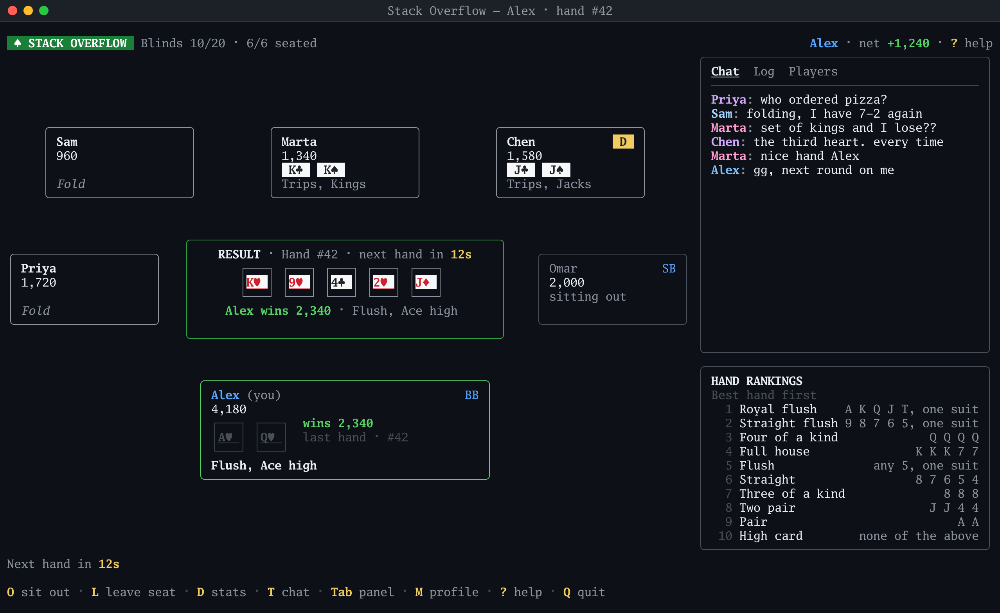

# Stack Overflow

No-Limit Texas Hold'em in the terminal. One person hosts, and everyone
joins with `ssh`. Players install nothing.

Up to 10 seats, chip banks, stats, chat, rabbit hunts, all-in run-outs, and
a settle-up that shows who pays whom. The game does not move real money.



## Host

You need macOS or Linux, Git, and Go 1.27.4 or later (<https://go.dev/dl/>).

```sh
git clone https://github.com/makaveli2p/stack-overflow.git
cd stack-overflow
go build -o bin/stack-overflow ./cmd/stack-overflow
./bin/stack-overflow
```

The server shows a join command such as `ssh -p 2222 yourname@192.168.1.9`.
Send it to your friends. Ctrl+C stops the server, and the server saves all
data in `~/.stack-overflow/`.

## Play

1. Run the join command with your own name. The host uses `127.0.0.1`.
2. Without an SSH key, choose a 4-digit PIN.
3. Push `S` to sit. When everyone sits, push `G` to deal.

| Key | Action |
|---|---|
| `C` | Check or call |
| `R` | Bet or raise (type an amount, then Enter) |
| `F` | Fold |
| `A` `A` | All-in |
| `T` | Chat |
| `?` | All keys |
| `Q` | Quit |

Use a terminal of 100 x 30 or larger. 80 x 24 also works.

## Play over the internet

Use [Tailscale](https://tailscale.com) and start the server with
`-host <your Tailscale IP>`. You can also forward TCP port 2222 on your
router. If you do, set a password with `STACK_OVERFLOW_PASSWORD=...`.

## More

The [full guide](docs/GUIDE.md) covers all flags, keys, admins, stats,
backups, Windows (WSL), firewalls and the other features.

MIT license.
